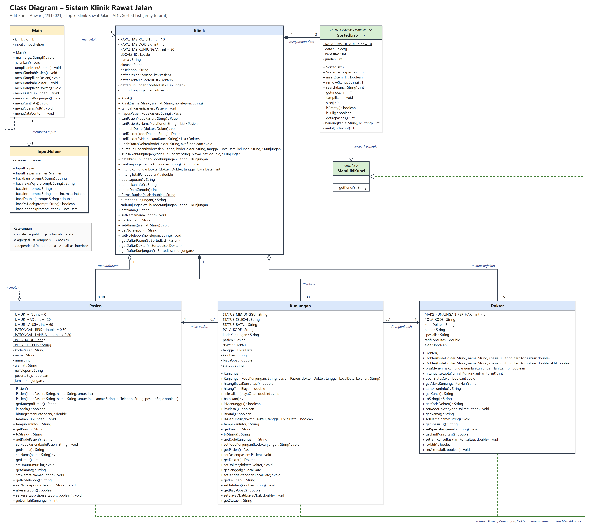
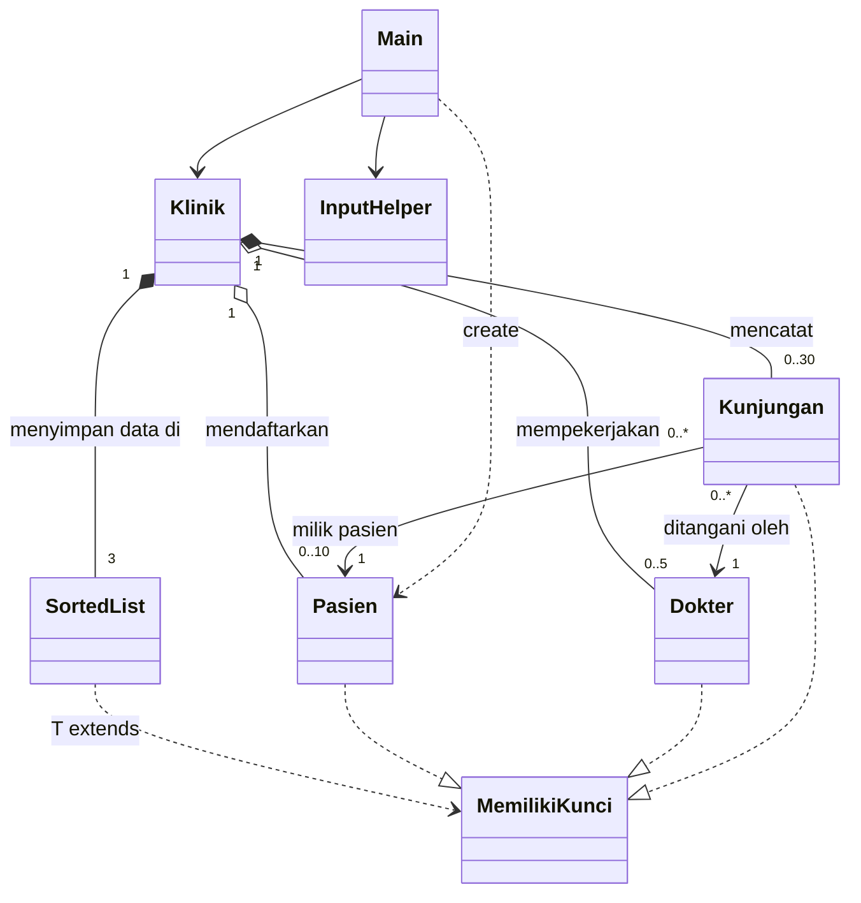

# LAPORAN UJIAN TENGAH SEMESTER
## Object Oriented Programming
### Sistem Manajemen Klinik Rawat Jalan Berbasis Console Java

| | |
|---|---|
| Nama | Adit Prima Anwar |
| NIM | 22315021 |
| Kelas | ........ |
| Topik | Klinik Rawat Jalan (digit terakhir NIM = **1**) |
| Jenis ADT | Sorted List / array terurut (digit kedua dari belakang = **2**, 2 mod 3 = **2**) |
| Repositori GitHub | https://github.com/......../UTS-POO_22315021_AditPrimaAnwar |
| Hash commit terakhir | ........ |
| Dosen | Muhammad Avied Bachmid, S.Kom., M.Kom. |
| Tahun | 2026 |

---

## BAB 1. Pendahuluan dan Analisis OOP

### 1.1 Deskripsi sistem
Klinik rawat jalan setiap hari menerima pasien yang ingin berobat ke dokter tertentu. Pencatatan manual
sering menimbulkan masalah: data pasien ganda, dokter menerima pasien melebihi kemampuan dalam sehari,
umur pasien salah tulis, dan total biaya harus dihitung ulang secara manual.

Aplikasi ini adalah program console Java untuk mengelola **pasien**, **dokter**, dan **kunjungan** (pendaftaran
berobat). Aplikasi menjaga aturan bisnis secara otomatis:
1. satu dokter maksimal **5 kunjungan per hari** (kunjungan batal tidak dihitung),
2. umur pasien harus **0 - 120 tahun**,
3. dokter nonaktif tidak bisa menerima kunjungan,
4. kode pasien/dokter tidak boleh ganda, tarif harus > 0, biaya obat tidak boleh negatif,
5. kunjungan hanya bisa diselesaikan/dibatalkan selama berstatus MENUNGGU,
6. pasien yang masih punya kunjungan MENUNGGU tidak bisa dihapus,
7. potongan konsultasi: BPJS 50%, lansia (>= 60 tahun) non-BPJS 20%.

Data disimpan di memori menggunakan ADT **Sorted List** buatan sendiri sehingga daftar pasien, dokter, dan
kunjungan selalu terurut berdasarkan kode dan pencarian berdasarkan kode bisa memakai *binary search*.

### 1.2 Objek dunia nyata yang dimodelkan

| Objek nyata | Class | Alasan pemilihan |
|---|---|---|
| Pasien | `Pasien` | Pihak yang berobat; punya data identitas (kode, nama, umur, BPJS) dan aturan umur 0-120. |
| Dokter | `Dokter` | Pihak yang melayani; punya tarif, spesialis, status aktif, dan batas 5 kunjungan/hari. |
| Kunjungan / pendaftaran berobat | `Kunjungan` | Transaksi utama yang menghubungkan pasien dan dokter, punya status dan biaya. |
| Klinik | `Klinik` | Wadah yang memiliki seluruh data dan menjalankan aturan bisnis. |
| Buku daftar yang tersusun urut | `SortedList<T>` | ADT penyimpan data yang selalu terurut berdasarkan kode. |
| Petugas pendaftaran / layar menu | `Main`, `InputHelper` | Antarmuka console dan validasi input pengguna. |

### 1.3 Perbandingan prosedural vs OOP
**Prosedural:** data disimpan dalam beberapa array terpisah, misalnya `String[] namaPasien`, `int[] umurPasien`,
`String[] namaDokter`, dan seterusnya, lalu diproses oleh fungsi-fungsi di satu file. Semua fungsi bisa
mengubah array secara langsung, sehingga aturan seperti "umur 0-120" harus dicek ulang di setiap fungsi yang
mengubah umur. Kalau satu tempat lupa dicek, data bisa rusak. Index antar-array juga harus selalu sinkron.

**OOP:** data dan perilaku disatukan di dalam class. Umur hanya bisa diubah lewat `setUmur()`, yang selalu
memvalidasi; kunjungan menyimpan referensi langsung ke objek `Pasien` dan `Dokter`, bukan index array.

**Keuntungan OOP pada kasus ini:**
- aturan bisnis cukup ditulis sekali di class yang bersangkutan, sehingga lebih aman dan konsisten;
- kode lebih mudah dibaca karena istilahnya sama dengan dunia nyata (`kunjungan.selesaikan()`, `dokter.bisaMenerimaKunjungan()`);
- ADT `SortedList` bisa dipakai ulang untuk tiga jenis data (pasien, dokter, kunjungan) berkat generics;
- perubahan, misalnya aturan potongan BPJS, cukup dilakukan di satu method (`Pasien.hitungPersenPotongan()`).

### 1.4 Prinsip abstraksi dan enkapsulasi pada project
**Abstraksi:** setiap class hanya memodelkan atribut dan perilaku yang relevan bagi klinik. Contohnya, `Pasien` tidak
menyimpan golongan darah atau riwayat penyakit karena tidak dibutuhkan sistem. Pengguna `SortedList` juga cukup
memanggil `insert`, `remove`, `search`, dan `get` tanpa perlu tahu cara elemen digeser atau cara *binary search*
bekerja. Interface `MemilikiKunci` mengabstraksikan "objek yang punya kunci" sehingga `SortedList` tidak perlu
mengenal Pasien, Dokter, ataupun Kunjungan.

**Enkapsulasi:** semua atribut bertanda `private`, termasuk konstanta. Akses dilakukan lewat getter/setter, dan setiap
setter memvalidasi nilai (umur, format kode, tarif, biaya obat, nomor telepon). Beberapa atribut sengaja **tidak diberi
setter publik**: `jumlahKunjungan` hanya bertambah lewat `tambahKunjungan()`, dan `status` kunjungan hanya berubah
lewat `selesaikan()` atau `batalkan()`. Dengan begitu, alur status MENUNGGU → SELESAI/BATAL tidak bisa dilompati.
Array internal `SortedList` juga private, sehingga urutan data tidak bisa dirusak dari luar.

Dua prinsip lain, yaitu **inheritance** dan **polymorphism**, belum menjadi cakupan UTS dan hanya muncul sederhana:
ketiga entitas mengimplementasikan interface `MemilikiKunci`, dan method `toString()` di-*override*.

---

## BAB 2. Perancangan

### 2.1 Class diagram
File sumber: `docs/class-diagram.drawio` (buka di https://app.diagrams.net, lalu ekspor sebagai PNG dan tempel di sini).



Ringkasan relasi (versi teks):



### 2.2 Penjelasan tiap class

**Pasien**

| Atribut | Tipe | Keterangan |
|---|---|---|
| kodePasien | String | Kunci unik, format P + 3 angka (P001) |
| nama | String | Tidak boleh kosong |
| umur | int | **0 - 120** (invariant wajib) |
| alamat | String | Boleh kosong ("-") |
| noTelepon | String | Kosong atau 8-15 digit |
| pesertaBpjs | boolean | Menentukan potongan 50% |
| jumlahKunjungan | int | Hanya bertambah lewat `tambahKunjungan()` |

| Method perilaku | Keterangan |
|---|---|
| `getKategoriUmur()` | Anak / Remaja / Dewasa / Lansia |
| `isLansia()` | true jika umur >= 60 |
| `hitungPersenPotongan()` | 0.5 untuk BPJS, 0.2 untuk lansia non-BPJS, 0 untuk lainnya |
| `tambahKunjungan()` | Menambah hitungan kunjungan |
| `tampilkanInfo()` | Info satu baris |

**Dokter**

| Atribut | Tipe | Keterangan |
|---|---|---|
| kodeDokter | String | Format D + 3 angka |
| nama | String | Tidak boleh kosong |
| spesialis | String | Kosong = "Umum" |
| tarifKonsultasi | double | Harus > 0 |
| aktif | boolean | Dokter nonaktif tidak bisa menerima kunjungan |

| Method perilaku | Keterangan |
|---|---|
| `bisaMenerimaKunjungan(int)` | aktif **dan** kunjungan hari itu < 5 |
| `hitungSisaKuota(int)` | 5 - jumlah kunjungan hari itu |
| `ubahStatus(boolean)` | Aktif/nonaktifkan dokter |
| `tampilkanInfo()` | Info satu baris |

**Kunjungan**

| Atribut | Tipe | Keterangan |
|---|---|---|
| kodeKunjungan | String | Dibuat otomatis oleh Klinik (K0001, K0002, ...) |
| pasien | Pasien | Relasi asosiasi ke pasien |
| dokter | Dokter | Relasi asosiasi ke dokter |
| tanggal | LocalDate | Tanggal berobat |
| keluhan | String | Tidak boleh kosong |
| biayaObat | double | >= 0, diisi saat kunjungan selesai |
| status | String | MENUNGGU / SELESAI / BATAL |

| Method perilaku | Keterangan |
|---|---|
| `hitungBiayaKonsultasi()` | tarif dokter × (1 − potongan pasien) |
| `hitungTotalBiaya()` | konsultasi + obat (0 jika batal) |
| `selesaikan(double)` | MENUNGGU → SELESAI, mencatat biaya obat |
| `batalkan()` | MENUNGGU → BATAL |
| `isAktifUntuk(Dokter, LocalDate)` | Dipakai untuk menghitung kuota harian dokter |

**Klinik:** atribut `nama`, `alamat`, `noTelepon`, tiga `SortedList`, dan `nomorKunjunganBerikutnya`. Method utamanya
`tambahPasien`, `hapusPasien`, `tambahDokter`, `buatKunjungan`, `selesaikanKunjungan`, `batalkanKunjungan`,
`cariPasien`/`cariPasienByNama`, `hitungKunjunganDokter`, `hitungTotalPendapatan`, `buatLaporan`, dan `muatDataContoh`.

**SortedList&lt;T extends MemilikiKunci&gt;**, **MemilikiKunci**, **Main**, **InputHelper**: lihat Bab 3 dan Bab 4.

### 2.3 Relasi dan multiplicity

| Relasi | Jenis | Multiplicity | Penjelasan |
|---|---|---|---|
| Klinik – Pasien | Agregasi | 1 – 0..10 | Objek Pasien dibuat di luar (menu), lalu didaftarkan ke klinik. Pasien tetap bermakna tanpa klinik. |
| Klinik – Dokter | Agregasi | 1 – 0..5 | Sama seperti pasien. |
| Klinik – Kunjungan | Komposisi | 1 – 0..30 | Kunjungan **hanya** dibuat di dalam `Klinik.buatKunjungan()`; tanpa klinik kunjungan tidak ada. |
| Kunjungan – Pasien | Asosiasi | 0..* – 1 | Satu kunjungan milik tepat satu pasien; satu pasien bisa punya banyak kunjungan. |
| Kunjungan – Dokter | Asosiasi | 0..* – 1 | Satu kunjungan ditangani tepat satu dokter. |
| Klinik – SortedList | Komposisi | 1 – 3 | Klinik membuat dan memiliki tiga list. |
| Pasien/Dokter/Kunjungan – MemilikiKunci | Realisasi | – | Ketiganya mengimplementasikan `getKunci()`. |
| Main – Klinik, InputHelper | Asosiasi | 1 – 1 | Menu memakai satu klinik dan satu pembaca input. |
| Main – Pasien/Dokter | Dependensi | – | Menu membuat objek baru dari input pengguna. |

---

## BAB 3. Implementasi

### 3.1 Struktur package dan file
```
src/klinik/
├── adt/
│   ├── MemilikiKunci.java   interface kunci pengurutan
│   └── SortedList.java      ADT array terurut (generic)
├── model/
│   ├── Pasien.java
│   ├── Dokter.java
│   ├── Kunjungan.java
│   └── Klinik.java
└── app/
    ├── Main.java            menu console
    └── InputHelper.java     validasi input keyboard
```
Total ada 8 file: 4 class entitas, 1 class ADT + 1 interface, dan 2 class aplikasi.

### 3.2 Konstruktor dan overloading
Setiap entitas punya konstruktor default dan konstruktor berparameter. `Pasien` dan `Dokter` juga menerapkan
**overloading** konstruktor, dan konstruktor pendek memanggil konstruktor lengkap lewat `this(...)`:

```java
public Pasien(String kodePasien, String nama, int umur) {
    this(kodePasien, nama, umur, "-", "-", false);
}

public Pasien(String kodePasien, String nama, int umur, String alamat,
              String noTelepon, boolean pesertaBpjs) {
    this.setKodePasien(kodePasien);
    this.setNama(nama);
    this.setUmur(umur);      // validasi umur ikut berjalan di konstruktor
    ...
}
```
Overloading method juga ada di `InputHelper.bacaInt(prompt)` dan `bacaInt(prompt, min, max)`.

### 3.3 Siklus hidup objek
1. **Dibuat:** `new Pasien(...)` di menu. Jika ada data tidak valid, konstruktor melempar exception sehingga objek
   tidak pernah tercipta dalam keadaan rusak.
2. **Didaftarkan:** `klinik.tambahPasien(p)` memasukkan referensi objek ke `SortedList`.
3. **Dipakai:** `buatKunjungan` membuat objek `Kunjungan` yang menyimpan referensi ke pasien dan dokter.
   Status kunjungan berubah MENUNGGU → SELESAI atau BATAL.
4. **Dihapus:** `hapusPasien` mengeluarkan referensi dari list. Setelah tidak ada referensi lain, objek akan dibersihkan
   oleh *garbage collector* Java. Semua data hilang saat program ditutup karena disimpan di memori.

### 3.4 Enkapsulasi dan validasi
```java
public void setUmur(int umur) {
    if (umur < UMUR_MIN || umur > UMUR_MAX) {
        throw new IllegalArgumentException("Umur pasien harus " + UMUR_MIN + " - " + UMUR_MAX
                + " tahun (input: " + umur + ")");
    }
    this.umur = umur;
}
```
Setter melempar `IllegalArgumentException`. Menu menangkapnya dan menampilkan `[GAGAL] pesan`, lalu
program kembali ke menu tanpa berhenti.

### 3.5 Aturan bisnis: batas 5 kunjungan per dokter per hari
```java
int jumlahHariItu = hitungKunjunganDokter(dokter, tanggal);   // tidak menghitung yang BATAL
if (!dokter.bisaMenerimaKunjungan(jumlahHariItu)) {
    throw new IllegalStateException("Kuota " + dokter.getNama() + " pada " + tanggal
            + " sudah penuh (" + jumlahHariItu + "/" + dokter.getMaksKunjunganPerHari() + " kunjungan)");
}
Kunjungan kunjungan = new Kunjungan(buatKodeKunjungan(), pasien, dokter, tanggal, keluhan); // komposisi
```

### 3.6 Catatan penyimpangan dari diagram
Tidak ada penyimpangan. Diagram disusun dari struktur class final. Getter/setter ditulis berpasangan dalam
satu baris di diagram agar gambar tetap terbaca.

---

## BAB 4. ADT Sorted List

### 4.1 Spesifikasi ADT
Kapasitas: pasien 10, dokter 5, kunjungan 30 (konstanta di `Klinik`). Kunci: `getKunci()`, yaitu kode,
dibandingkan tanpa membedakan huruf besar/kecil.

| Operasi | Parameter | Nilai kembali | Prasyarat | Efek |
|---|---|---|---|---|
| `insert` | `T item` | boolean | List belum penuh, item tidak null, kunci belum ada | Item disisipkan di posisi yang menjaga urutan; size +1. Mengembalikan false jika penuh/duplikat. |
| `remove` | `String kunci` | T / null | List tidak kosong, kunci ada | Elemen dihapus, elemen setelahnya digeser ke kiri; size −1. Mengembalikan null jika tidak ditemukan. |
| `search` | `String kunci` | int | – | Binary search; index elemen, atau −1 jika tidak ada/list kosong. |
| `get` | `int index` | T / null | 0 ≤ index < size | Mengembalikan elemen tanpa menghapus; null jika index di luar jangkauan. |
| `tampilkan` | – | void | – | Mencetak semua elemen dengan index; "(list kosong)" jika kosong. |
| `size` | – | int | – | Jumlah elemen. |
| `isEmpty` / `isFull` | – | boolean | – | Mengecek kondisi kosong / penuh. |
| `getKapasitas` | – | int | – | Kapasitas maksimum. |

### 4.2 Ilustrasi cara kerja insert (tetap terurut)
Isi awal: `[P001, P003, P005, _, _]`. Lalu `insert(P002)` dijalankan:

```
posisi = 3 (jumlah)
P005 > P002 -> geser ke kanan  : [P001, P003, _   , P005, _]  posisi = 2
P003 > P002 -> geser ke kanan  : [P001, _   , P003, P005, _]  posisi = 1
P001 < P002 -> berhenti, isi   : [P001, P002, P003, P005, _]
```

Binary search `search("P003")` pada `[P001, P002, P003, P005]`:
```
kiri=0 kanan=3 tengah=1 (P002) < P003 -> kiri=2
kiri=2 kanan=3 tengah=2 (P003) == P003 -> ketemu, index 2
```

### 4.3 Analisis kompleksitas

| Operasi | Kompleksitas | Alasan |
|---|---|---|
| insert | O(n) | Pengecekan duplikat O(log n), lalu menggeser hingga n elemen |
| remove | O(n) | Search O(log n), lalu menggeser hingga n elemen |
| search | O(log n) | Binary search memanfaatkan data yang terurut |
| get | O(1) | Akses langsung index array |
| tampilkan | O(n) | Mengunjungi setiap elemen |
| size, isEmpty, isFull | O(1) | Membaca atribut `jumlah` |

---

## BAB 5. Pengujian

Input uji disimpan di folder `tests/uji*.txt`, dan keluarannya di `tests/hasil_uji*.txt`.
(Jalankan: `java -cp out klinik.app.Main < tests\uji1_normal.txt`.)

| No | Skenario | Input | Hasil yang diharapkan | Hasil aktual | Status |
|---|---|---|---|---|---|
| 1 | Normal: tambah pasien | P004, Adit Prima, 20 th | Pasien masuk dan list tetap urut | `[OK] Pasien berhasil ditambahkan`, P004 tampil di index 3 di antara P003 dan P005 | Lulus |
| 2 | Normal: buat kunjungan | P004 → D001, hari ini, "Demam dan batuk" | K0001 dibuat, biaya Rp50.000 | `[OK] Kunjungan K0001 dibuat. Biaya konsultasi: Rp50.000, sisa kuota 4` | Lulus |
| 3 | Normal: selesaikan dan laporan | K0001, obat 25000 | Total Rp75.000, pendapatan Rp75.000 | `K0001 SELESAI ... = Rp75.000`; laporan `Total pendapatan : Rp75.000` | Lulus |
| 4 | Normal: potongan BPJS | P001 (BPJS) → D002 tarif 75.000 | Biaya Rp37.500 | `Biaya konsultasi: Rp37.500` | Lulus |
| 5 | Aturan: umur di luar 0-120 | Umur 130 | Ditolak dengan pesan | `[GAGAL] Umur pasien harus 0 - 120 tahun (input: 130)` | Lulus |
| 6 | Aturan: kunjungan ke-6 dokter pada hari yang sama | 6× kunjungan D001 tgl 2026-12-01 | Kunjungan ke-6 ditolak | `[GAGAL] Kuota dr. Andi Pratama pada 2026-12-01 sudah penuh (5/5 kunjungan)` | Lulus |
| 7 | Aturan: dokter nonaktif | P002 → D003 | Ditolak | `[GAGAL] Dokter dr. Budi Santoso, Sp.A sedang NONAKTIF` | Lulus |
| 8 | Aturan: kode ganda | Tambah pasien P001 lagi | Ditolak | `[GAGAL] Kode pasien P001 sudah terdaftar` | Lulus |
| 9 | Aturan: selesaikan kunjungan batal | Batalkan K0001, lalu selesaikan K0001 | Ditolak; kuota kembali | `[GAGAL] Kunjungan K0001 berstatus BATAL`; kunjungan baru K0006 diterima | Lulus |
| 10 | Aturan: hapus pasien yang masih menunggu | remove P002 | Ditolak | `[GAGAL] Pasien P002 masih punya kunjungan MENUNGGU (K0002)` | Lulus |
| 11 | ADT kosong | search / get / remove saat list kosong | Pesan, tanpa crash | `[INFO] List KOSONG ...`, `[GAGAL] Daftar pasien KOSONG ...`, `size = 0 ... isEmpty = true` | Lulus |
| 12 | ADT penuh | Tambah pasien ke-11 (P012) | Ditolak, isFull = true | `[GAGAL] Daftar pasien PENUH (kapasitas 10)`; `size = 10 dari kapasitas 10 ... isFull = true` | Lulus |
| 13 | ADT: data tidak ditemukan | search P099, get(99) | −1 / di luar jangkauan | `search: kode P099 tidak ditemukan (-1)`, `get: index 99 di luar jangkauan` | Lulus |
| 14 | Input tidak valid: huruf pada kolom angka | Menu "abc", umur "dua puluh", tarif "lima puluh ribu", biaya "seribu" | Diminta mengulang | `[!] Input harus berupa angka ..., silakan ulangi.` | Lulus |
| 15 | Input tidak valid: kosong dan format salah | Kode/nama kosong, tanggal "23-11-2026", telepon "abc", kode "X12", tarif −5000 | Diminta mengulang atau ditolak | `[!] Input tidak boleh kosong`, `[!] Format tanggal salah`, `[GAGAL] Nomor telepon harus 8-15 digit`, `[GAGAL] Kode pasien harus berformat P + 3 angka`, `[GAGAL] Tarif konsultasi harus lebih dari 0` | Lulus |

> [Tempel screenshot setiap skenario di sini]

---

## BAB 6. Penutup

### 6.1 Kesimpulan
Aplikasi Klinik Rawat Jalan berhasil dibangun dengan 4 class entitas, 1 ADT Sorted List generik, dan class menu.
Seluruh atribut ter-enkapsulasi dengan validasi di setter, dan semua aturan bisnis (umur 0-120, maksimal 5 kunjungan
per dokter per hari, dan lainnya) berjalan dengan pesan kesalahan yang jelas tanpa membuat program berhenti.
ADT Sorted List menjaga data selalu terurut sehingga pencarian berdasarkan kode bisa memakai binary search.

### 6.2 Kendala
- *(isi dengan pengalaman sendiri, misalnya memahami cara menggeser elemen array saat insert/remove)*
- *(misalnya membedakan agregasi dan komposisi di class diagram)*

### 6.3 Refleksi pembelajaran
*(isi dengan kata-kata sendiri)*

---

## Daftar Pustaka
1. Oracle. *The Java Tutorials – Object-Oriented Programming Concepts*. https://docs.oracle.com/javase/tutorial/java/concepts/
2. Oracle. *Java SE API Documentation*. https://docs.oracle.com/en/java/javase/
3. Goodrich, M. T., Tamassia, R., & Goldwasser, M. H. (2014). *Data Structures and Algorithms in Java* (6th ed.). Wiley.
4. Materi kuliah Object Oriented Programming, Muhammad Avied Bachmid, S.Kom., M.Kom.

## Lampiran
- Link repositori GitHub: ........
- Hash commit terakhir: ........
- Link video demo: ........

**Pernyataan orisinalitas**

Saya yang bertanda tangan di bawah ini, nama: Adit Prima Anwar, NIM: 22315021, menyatakan bahwa project
UTS Pemrograman Berorientasi Objek ini adalah hasil karya saya sendiri. Sumber rujukan dan bantuan alat telah saya
cantumkan. Saya bersedia menerima sanksi akademik apabila pernyataan ini tidak benar.

Kendari, ........ 2026 · Tanda tangan: ........
